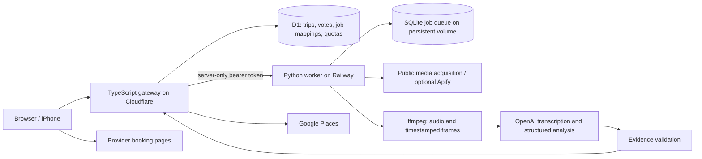

# Architecture and trade-offs

25 November 2026. This note describes the implemented prototype, not a future scale-out design.

## Request lifecycle

The gateway validates submitted links, applies usage limits and starts or reuses a bounded job. A separate worker acquires media, validates source identity and media size, overlaps transcription with frame preparation, and requests structured analysis. Quotes and names are checked against supplied evidence; one bounded correction attempt is allowed. Failures remain explicit. Saved links survive processing failures.

The browser polls active analyses more frequently than idle trips. Server claims prevent several viewers from multiplying worker polls. Venue lookup runs with limited concurrency. Automatic match caches fingerprint the trusted lookup input: a place cannot inherit another venue's match merely because a reanalysis reused its position. User-confirmed fixes are scoped separately. Maps render available pins progressively and preserve the camera through normal polling.

## State and trust boundaries

Personal library/bundle state lives on the device. Shared buckets and votes live in D1. The iOS App Group stores pending shares; the containing app imports them. The extension saves locally before submitting analysis. It renders its own UIKit controls and bounds attachment reads to avoid an indefinitely blank host sheet.

Model output is untrusted. Captions, screen text and speech are evidence, not instructions. Provider credentials remain server-side. Booking links are handoffs; they do not establish price, availability or a completed transaction. Ambiguous venues remain uncertain rather than becoming confident map pins.

## Why this deployment

A separate Python worker keeps media processing off travellers' phones and outside short web-request lifetimes. Cloudflare serves the UI and gateway; Railway supplies a long-running worker and persistent volume. The worker uses one replica with SQLite and bounded subprocesses. That is a deliberate prototype constraint, not a horizontally scalable distributed queue. A genuine high-volume release would require capacity measurements, a shared durable queue, stronger account/abuse controls and operational ownership.

See the implementation's worker guide for retention, restart handling, limits and required secrets. No production keys or deployable account identifiers are included in the public configuration.
